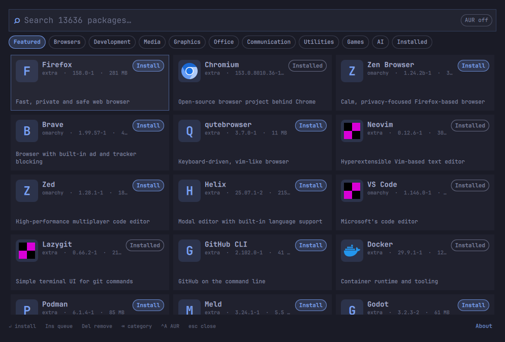

<div align="center">

# Hangar Store

**A themed app store for Omarchy.**

An Omarchy shell plugin. Browse curated apps by category, search every
package in your repositories, and install or remove with one key.


<br><br>



</div>

## Install

```bash
omarchy plugin add https://github.com/<user>/omarchy-hangar-store.git --enable --yes
```

Open it with:

```bash
omarchy-shell shell toggle peter.hangar-store
```

Bind that command to a key in `~/.config/hypr/bindings.lua` if you want a shortcut.

## Features

- Curated apps in nine categories: Browsers, Development, Media, Graphics, Office, Communication, Utilities, Games and AI.
- Live search across every package in your configured repositories.
- Optional AUR search (toggle with `Ctrl+A`).
- Install queue: mark several apps, then install them in one go.
- Shows installed state, repository, version and size for each package.
- Follows the current Omarchy theme, font and corner radius.
- Curated entries that do not exist for your architecture (for example x86-only apps on ARM) are hidden automatically.

## Keys

| Key | Action |
|---|---|
| Type | Filter / search |
| `Enter` | Install the queue, or the selected app if the queue is empty |
| `Insert` / `Ctrl+Space` | Add or remove the selected app in the install queue |
| `Delete` | Remove the selected installed app |
| `Tab` / `Shift+Tab` | Next / previous category |
| `Ctrl+A` | Toggle AUR search |
| Arrow keys, `PgUp`, `PgDn` | Move the selection |
| `Esc` | Clear the filter, then close |

## How it works

Hangar Store does not install anything itself. It opens a floating terminal and runs
the standard Omarchy helpers, so you see exactly what happens and can enter your
password there:

- `omarchy-pkg-add` for repository packages
- `omarchy-pkg-aur-add` for AUR packages
- `omarchy-pkg-drop` for removal

Package names are validated before they reach a command line. The plugin reads your
package databases with `expac` and `pacman -Q`. AUR search is off by default; when
enabled it queries the AUR RPC over HTTPS.

Plugins run unsandboxed, so read the code before you install it. It is one QML file
and two small JavaScript files.

## Requirements

- Omarchy 4.x with `omarchy-shell`
- `expac`, `pacman`, `curl`
- `yay` (or whatever `omarchy-pkg-aur-add` uses) for AUR installs

## Customize the catalog

Edit `Catalog.js`. Each entry is `{ n: name, p: package, c: category, d: description }`,
with `a: true` for AUR packages.

## License

MIT, see [LICENSE](LICENSE).
